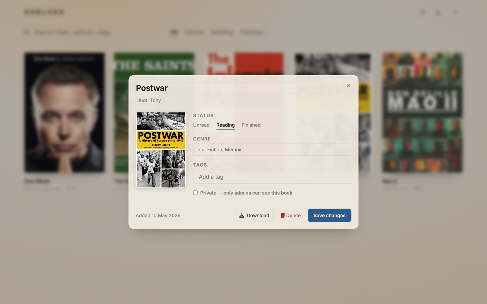
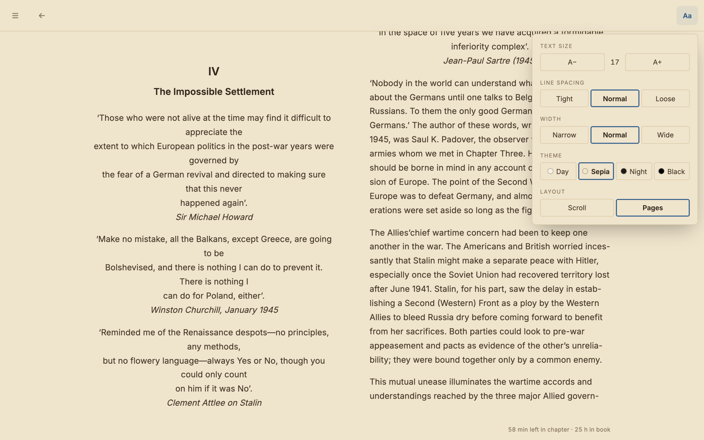

# Shelves

A personal EPUB library and reader for the home stack: covers hung on a warmly lit gallery wall, and a calm, book-like page for reading them.


<p>
  
  
</p>


<p>
  
  
</p>


## Features

- **The gallery**: covers with title, author and how far you've read, five to a row on a laptop; a bookshelf of spines as an alternative. It opens on what you're reading.
- **Search and filter** across titles, authors, genres and tags; *Unread*, *Reading* and *Finished*.
- **The reader**: continuous scroll or two-page spreads, no toolbars while you read, the chapter and time left in the margins. Text size, spacing, width and four themes (Day, Sepia, Night, Black) under `Aa`.
- **Footnotes** open beside their marker, and any jump inside the book offers a way back.
- **Ask and Explain**: select text to ask about it, or for a definition or translation in context (Claude; needs `ANTHROPIC_API_KEY`).
- **Read aloud** with your device's own voices (free, no account): the sentence being read is highlighted, and the pages turn or scroll to keep up. English, Mandarin and Cantonese, each from the book's language tags; a book's Chinese can be set to read as Mandarin or Cantonese, and each language's voice chosen, under `Aa`. Tap a sentence to read from there; `L` starts and pauses.
- **Vertical text** for Chinese and Japanese books (直排): lines top to bottom, right to left, pages turning leftwards, with one- and two-digit numbers upright. On by default when the book asks for it, and set per book under `Aa`.
- **Your place everywhere**: progress syncs across devices, and the paragraph you stopped at is marked when you return.
- **Managing books**: add EPUBs by upload or drag and drop, edit details and covers, tag books, mark them private.
- **Safe edits**: deletes go to a 30-day trash with Undo.
- **Installable**, and the last 12 books you opened stay readable offline. `?` lists the keyboard shortcuts.

## Comics

Comics (`/comics/`) work like the books: everyone signed in sees the series there are files for, filtered by All / Unread / Reading / Finished (opening on Reading when something's in progress). A cover picks up where you left off; ⋯ shows every issue as a cover, each with a ✓ to mark it read.

- **Files**: comics are matched to their issue (by ComicInfo.xml or filename) and written as CBZs with WebP pages, a ComicInfo.xml and a MetronInfo.xml (the original filename is kept in the notes), under `<Publisher>/<Series (Year)>/<Series> #001 (Year).cbz`.
- **The reader**: one page, two-page spreads (the cover alone, wide pages alone) or one long scroll; fit to height or width; right to left for manga; tap, swipe or the arrow keys. Your page is saved, and the next issue is a tap away at the end.
- **For admins**, a series' missing issues show as faded covers saying what each is waiting for; ⋯ on one searches, picks a release, skips or adds a file, and **Select** wants or skips several.

## Get and Downloads (admins)

One place to ask for things and one to follow them, for books and comics alike:

- **Get** (`/get`) searches Open Library for books and ComicVine or Metron for comic series together. Tap a book to ask for it; tap a series to follow it (new issues from now on, every missing issue, or only the ones you pick).
- **Wanted books and issues are searched for** every few hours on your Newznab (usenet) and Torznab (torrent, via Prowlarr or Jackett) indexers, in their ebook (7020) or comics (7030) categories. The best release goes to SABnzbd or qBittorrent, filed under the client's books or comics category, or is saved to a blackhole folder. Books need the title's words and the author's surname and an EPUB (audiobooks, PDFs and collections are skipped); comics are matched on series, issue number and year. A release that failed isn't grabbed again for the same thing; **Pick** shows every release and why each one fits or doesn't.
- **Downloads** (`/downloads`) is one page: what's downloading, everything wanted (a line per book, a group per comic series), importing — drop EPUBs or comics anywhere on the page, or into the import folder — the next two months of comics by shop date, the history, and the background jobs.
- **Settings** (the menu, `/settings`) holds the indexers, download clients, where finished downloads are and how releases are chosen (with a size limit for books and one for comics), then the comics-only parts: ComicVine/Metron and how files are written.

One background worker does it all, in one gunicorn process (a file lock picks it), from the first request after a restart.

## Run it

```sh
uv sync
cp .env.example .env                                  # set SECRET_KEY and BOOK_DIR
mkdir -p "$BOOK_DIR"
uv run flask db upgrade
uv run flask create-user <username> <password> --role admin
uv run flask run --port 8002                          # http://127.0.0.1:8002
```

Or with Docker: `docker compose up -d`.

Tests and lint: `uv run pytest` and `uvx ruff check .`

### Settings

| Variable | Does |
|---|---|
| `SECRET_KEY` | Signs sessions (required) |
| `BOOK_DIR` | Where the EPUBs live (must exist) |
| `ANTHROPIC_API_KEY` | Turns on Ask and Explain (optional) |
| `TRASH_RETENTION_DAYS` | How long deleted books are kept (default 30) |
| `COMIC_DIR` | Where comics live (default `instance/comics`) |
| `IMPORT_DIR` | Folder whose comics and EPUBs get imported (default `COMIC_DIR/_import`) |
| `COMICVINE_API_KEY`, `METRON_USERNAME`, `METRON_PASSWORD` | Metadata, if not set in the app |

## Home stack

Served at `/library/` behind the [dashboard](../dashboard)'s nginx, which signs people in and passes the user on. Set:

```sh
AUTH_PROXY_HEADER=X-Forwarded-User
APPLICATION_ROOT=/library
```

Leave both unset for standalone development. Accounts are created on first visit.

Commits merged to `master` that pass CI deploy to the Pi on their own (see the dashboard README). The container applies database migrations when it starts; release notes are in [`MIGRATION.md`](MIGRATION.md).

## Commands

```sh
uv run flask import-books --directory <path>                # add every EPUB in a folder
uv run flask create-user <username> <password> [--role admin]
uv run flask refresh-cover-paths                            # re-find each book's cover
uv run flask purge-trash [--days 30]                        # empty the trash (also runs on delete)
uv run flask backup-db --to <path> [--keep N]               # consistent SQLite snapshot while running
```

Cover thumbnails (`instance/thumbs/`), caches (`instance/cache/`) and pending uploads (`BOOK_DIR/.incoming/`) can all be deleted safely. Planned work is in [`docs/roadmap.md`](docs/roadmap.md).
