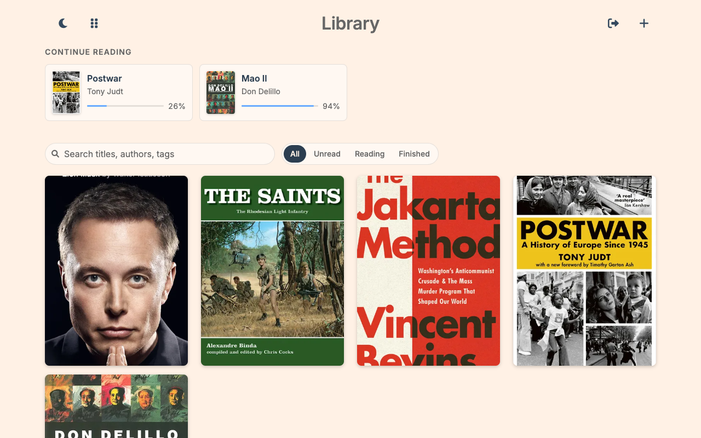
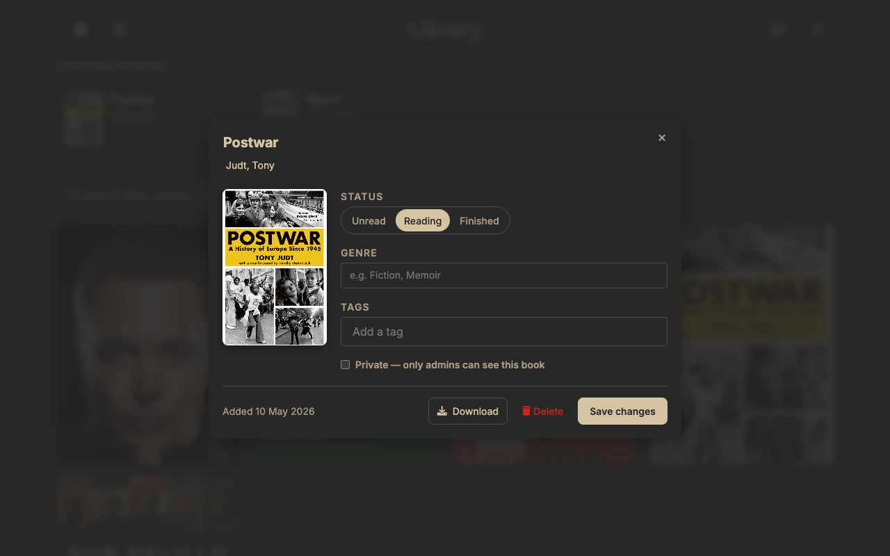
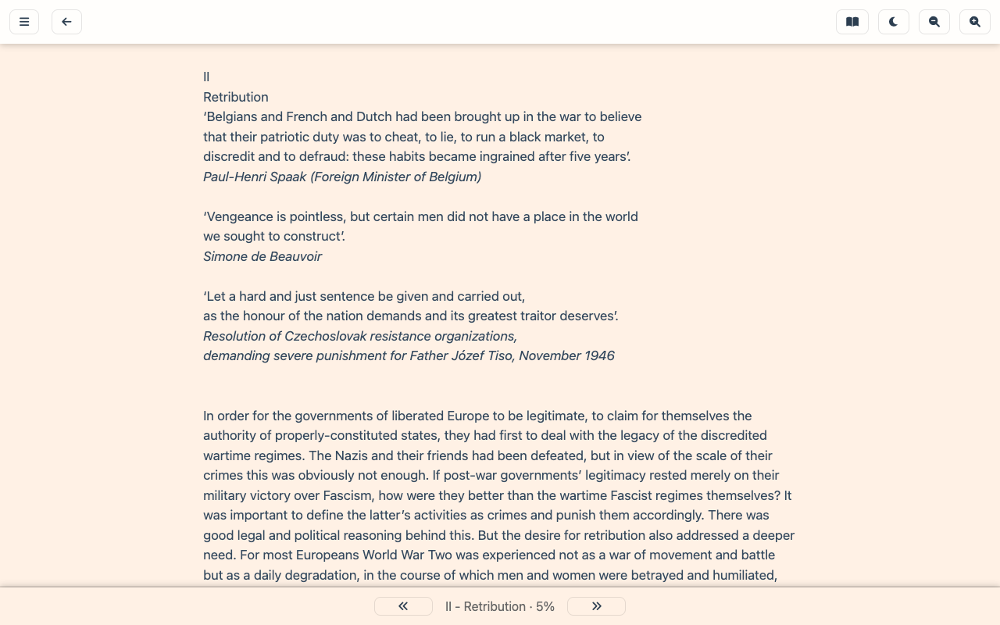
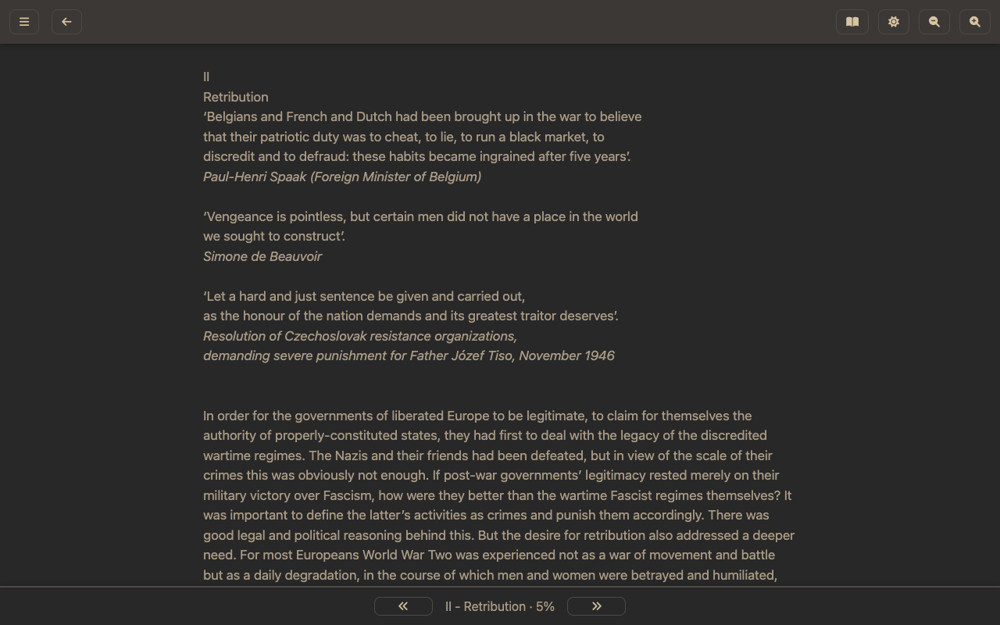
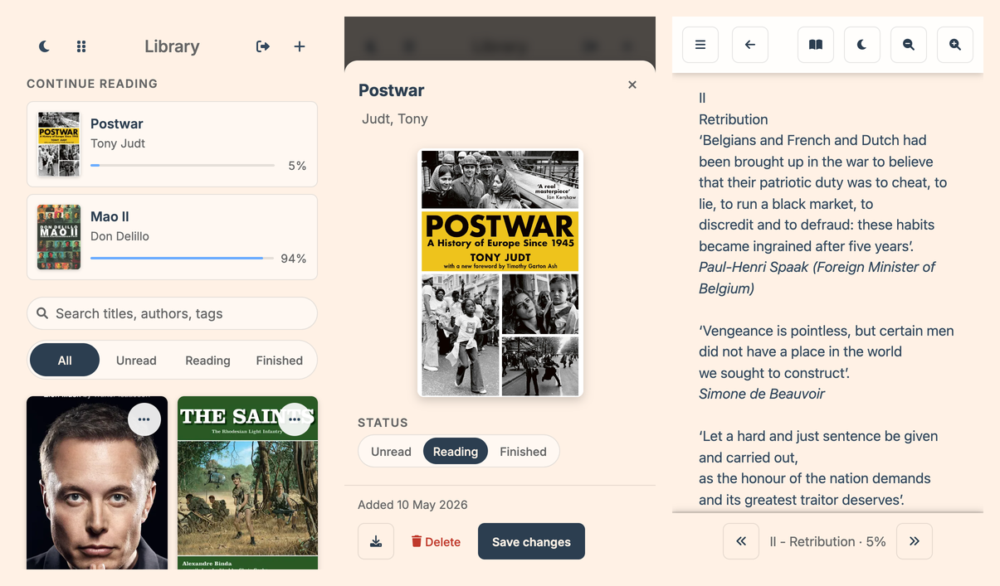

# INQUIRE: AI-Enhanced EPUB Library

## Overview











## Features

- **Library**
  - Cover grid or a bookshelf of spines (spine thickness scales with the book's length).
  - **Continue reading** row: the books you're in the middle of, most recent first, with how far through each one you are.
  - One search box that matches titles, authors, genres and your tags.
  - Reading status — *Unread*, *Reading*, *Finished* — as a filter on the library and a control on each book.
  - Your own tags per book, with autocomplete.
  - Covers served as small WebP thumbnails; books without a cover get a typographic one.
- **Adding and managing books**
  - Add EPUBs with the **+** button or by dropping files onto the page; several at once is fine.
  - A single book opens a review panel (title, author, genre, tags) before it's added; nothing lands in the library until you confirm.
  - Change a book's cover, title, author and genre (admins), or mark a book private so only admins see it.
  - Delete moves a book to the trash with **Undo**; the trash empties itself after 30 days.
  - Download the EPUB from a book's details.
- **Reader**
  - Scroll or paginated layouts; on wide screens, paginated mode shows a two-page spread.
  - Remembers your place per book, on the device and (signed in) across devices.
  - Shows the chapter you're in and your progress through the whole book.
  - Night mode and text size, contents panel, and an offer to mark the book finished near the end.
- **Reading assistant (AI)**
  - Select text, then **Ask** a question about it or **Explain** it: a word gets a definition in context, foreign text a translation, a passage a short gloss.
  - Needs `ANTHROPIC_API_KEY` and a signed-in user.
- **Phones and offline**
  - Built for phones: bottom sheets, large tap targets, safe areas for notches; press and hold a book for its details.
  - Installable as an app (web manifest) and usable offline: the last 12 books you opened, plus covers, are kept on the device.
- **Keyboard (desktop)**
  - Library: `/` search, `U` add a book, `Esc` close a panel.
  - Reader: `←` / `→` page (or screen, in scroll mode), `Shift` + `←` / `→` section, `T` contents, `+` / `-` text size, `N` night mode, `A` ask and `E` explain (with text selected), `Esc` close, `?` all shortcuts.

## Installation

1. **Clone the repository**:
   ```bash
   git clone git@github.com:ego-alt/library.git
   cd library
   ```

2. **Configure environment variables**:
   Create a `.env` file in the project root (see `.env.example` for all options):
   ```bash
   SECRET_KEY=a_long_random_string
   ANTHROPIC_API_KEY=your_api_key_here
   BOOK_DIR=/path/to/your/books
   ```

3. **Books directory**:
   `BOOK_DIR` must exist and be a directory before the app starts (create it if needed):
   ```bash
   mkdir -p "$BOOK_DIR"
   ```

4. **Build and run with Docker Compose**:
   ```bash
   docker compose up -d
   ```

5. **Alternative (local) setup**:
   Ensure you have Python (3.10+) and `uv` installed:
   ```bash
   uv sync
   uv run flask db upgrade
   uv run flask run --port=8002
   ```

### Upgrading

Behind the dashboard, the container runs `flask db upgrade` every time it
starts, and the Pi's deploy timer rebuilds it when new commits pass CI (see the
dashboard README, "Deploying"). Running standalone, after pulling:

```bash
uv run flask db upgrade
docker compose build && docker compose up -d
```

See `MIGRATION.md` for release-specific notes.

### Files the app writes

Besides the database, the app keeps a few things it can always rebuild:

- `instance/thumbs/` — cover thumbnails
- `instance/cache/` — cached cover bytes and book sizes
- `BOOK_DIR/.incoming/` — uploads waiting for you to confirm them (unconfirmed ones are removed after a day)

All of these are safe to delete.

## Home stack (with dashboard)

Served at `/library/` behind the [dashboard](../dashboard) nginx proxy, gated by
its `auth_request` and wired into `../dashboard/docker-compose.yml` (internal
port `5001`). In that mode, set:

```bash
AUTH_PROXY_HEADER=X-Forwarded-User
APPLICATION_ROOT=/library
```

Dashboard handles login; this app trusts the `X-Forwarded-User` header and keeps
its own `users` rows for bookmarks and tags. Omit both variables for standalone
dev (local login on port 8002).

After adding a user in dashboard, sync shadow accounts:

```bash
cd ../dashboard && uv run python scripts/sync_household_users.py
```

> On the Pi, merged commits that pass CI deploy themselves within about five
> minutes (see the dashboard README, "Deploying"). To deploy by hand: code is
> baked into the image at build time, so after pulling run
> `docker compose build library && docker compose up -d library`. A bare `up -d`
> reuses the old image.

See `dashboard/README.md` for compose and user sync.

## Usage

- **Open it**: go to `http://127.0.0.1:8002` (or `/library/` behind the dashboard).
- **Add books**: press **+** or drop EPUB files on the library. One file opens a review panel; several are added straight away using each EPUB's own metadata. EPUBs need a table of contents (EPUB 3 nav or EPUB 2 NCX). For a whole folder at once, use `flask import-books` (below).
- **Find a book**: type in the search box, or switch between *All*, *Unread*, *Reading* and *Finished*.
- **Book details**: the **⋯** button on a cover (or press and hold on a phone) opens status, tags, genre, cover and Download; admins can also edit title and author, make a book private, or delete it.
- **Read**: tap a cover or a *Continue reading* card. Your place is saved as you read.
- **Offline**: books you've opened recently keep working without a connection; others are dimmed until you're back online.

## Commands

The application includes several CLI commands for managing books:

- **Import Books**: Import EPUB files from a specified directory.
  ```bash
  uv run flask import-books --directory /path/to/epub/files
  ```

- **Refresh cover paths**: Re-scan each EPUB’s package document and update stored `cover_path` values (optional; serving covers no longer depends on this being perfect).
  ```bash
  uv run flask refresh-cover-paths
  ```

- **Create User**: Create a new user account.
  ```bash
  uv run flask create-user <username> <password> --role <role>
  ```

- **Empty the trash**: Permanently remove books deleted more than `--days` ago
  (default `TRASH_RETENTION_DAYS`, 30), including their EPUB files. This also
  runs automatically whenever a book is deleted, so scheduling it is optional.
  ```bash
  uv run flask purge-trash
  uv run flask purge-trash --days 0   # empty the trash now
  ```

- **Backup DB**: Take an online SQLite snapshot of the library DB. Safe with
  the app running (uses SQLite's online backup API, not `cp`). Writes
  `library-YYYYMMDD-HHMMSS.db` into `--to` and keeps the last `--keep`
  (default 14). Recommended: schedule via cron, and write backups to a
  *different* physical disk than the live DB.
  ```bash
  uv run flask backup-db --to /mnt/backup/library-backups
  # crontab example (3am daily, keep 30):
  # 0 3 * * * cd /path/to/library-app && uv run flask backup-db --to /mnt/backup/library-backups --keep 30
  ```

## Contributing

1. Fork the repository
2. Create your feature branch (`git checkout -b feature/new-feature`)
3. Commit your changes (`git commit -m 'Add some new feature'`)
4. Push to the branch (`git push origin feature/new-feature`)
5. Open a Pull Request