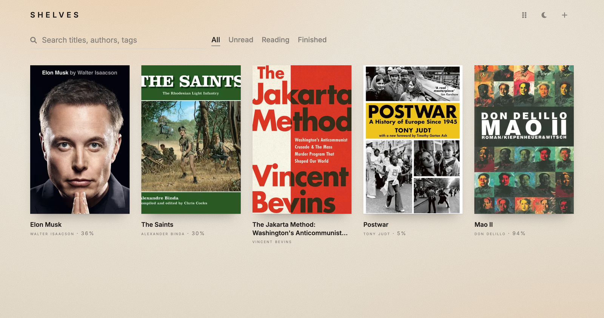
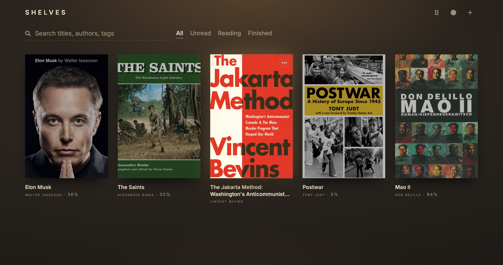
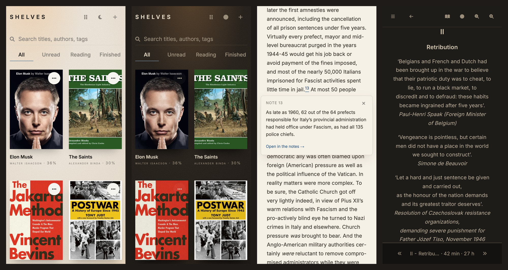

# Shelves

An EPUB library for the home stack, hung like a gallery wall in warm light: sun through a paper blind by day, a reading lamp at night. The reader leaves all of that behind for a calm, even page.








## Features

- **The gallery**: covers at their real proportions, five across on a laptop, each labelled with title, author and how far in you are. It opens on what you're reading when something's in progress. A bookshelf view of spines is one tap away.
- **Find and sort**: one search box for titles, authors, genres and your tags; *All*, *Unread*, *Reading* and *Finished*.
- **A reader built for long sessions**:
  - a flat page with softened contrast (about 10:1 by day, 8.6:1 at night);
  - 70–85 characters a line, generous line spacing and gentle hyphenation;
  - scroll or paginated, with two-page spreads on wide screens.
- **Reading aids**:
  - **time left** in the chapter and book, learned from your own reading speed;
  - footnotes in a **pop-up** beside the marker, and **↩ Back** after any other jump;
  - the book's own **structure** kept (centred titles, italics, small caps, poem indents) while its fonts, colours and spacing give way to the reader's.
- **Ask and Explain**: select text to ask about it, or get a definition, translation or short gloss (Claude; needs `ANTHROPIC_API_KEY`).
- **Your place everywhere**: saved as you read, on the device and across devices.
- **Books**: add with **+** or by dropping files, edit details, change covers, mark private, delete with Undo (a 30-day trash).
- **Phones and offline**: installable; the last 12 books you opened work without a connection. `?` lists the keyboard shortcuts.

## Run it

```sh
uv sync
export BOOK_DIR=/path/to/books                 # must exist
uv run flask db upgrade
uv run flask run --port=8002                   # http://127.0.0.1:8002
```

Or `docker compose up -d`. Settings go in `.env` (see `.env.example`): `SECRET_KEY`, `BOOK_DIR`, and optionally `ANTHROPIC_API_KEY`.

Tests and lint: `uv run pytest` and `uvx ruff check .`

The app also writes `instance/thumbs/` (cover thumbnails), `instance/cache/` (cached covers, sizes and book styles) and `BOOK_DIR/.incoming/` (uploads awaiting confirmation). All are safe to delete.

## Home stack

Served at `/library/` behind the [dashboard](../dashboard)'s nginx, which signs people in. Set:

```sh
AUTH_PROXY_HEADER=X-Forwarded-User
APPLICATION_ROOT=/library
```

The app trusts that header and keeps its own `users` rows for bookmarks and tags; accounts are created on first visit. Commits merged to `master` that pass CI deploy to the Pi on their own (see the dashboard's `docs/DEPLOY.md`), and the container runs `flask db upgrade` when it starts. `MIGRATION.md` has release-specific notes.

## Commands

```sh
uv run flask import-books --directory /path/to/epubs    # add a folder of EPUBs
uv run flask refresh-cover-paths                        # re-scan cover locations
uv run flask create-user <username> <password> --role <role>
uv run flask purge-trash [--days 0]                     # empty the trash (also runs on delete)
uv run flask backup-db --to /mnt/backup/library-backups [--keep 14]   # online SQLite snapshot
```
